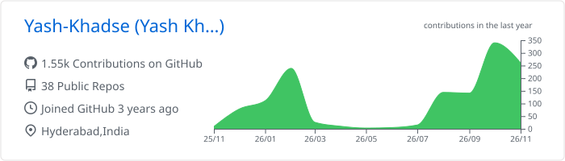
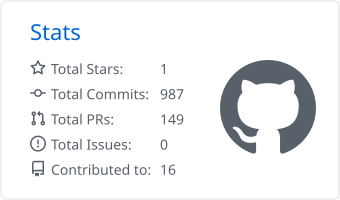
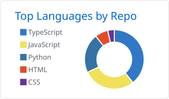
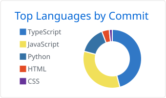
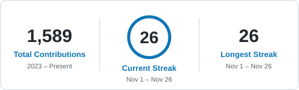

<!-- ═══════════════════════════ HEADER ═══════════════════════════ -->
<div align="center">


<a href="https://www.yashkhadse.com">
  
</a>

<br />

<a href="https://www.yashkhadse.com"></a>
<a href="https://www.linkedin.com/in/yash-khadse-4yk"></a>
<a href="https://www.yashkhadse.com/Yash-Khadse-Resume.pdf"></a>
<a href="mailto:khadseyash4@gmail.com"></a>
<a href="https://x.com/_yasssh"></a>

<br /><br />


</div>

<br />

<!-- ═══════════════════════════ ABOUT ═══════════════════════════ -->
## 👨‍💻 About

```ts
const yash = {
  role:       "AI Engineer & Full-Stack Developer",
  location:   "Hyderabad, India (UTC+05:30)",
  focus:      ["LLM systems", "RAG", "Agents", "Full-stack engineering"],
  shipped:    ["Nucel", "NyraAI", "NS4 Inc platform"],
  education:  "B.Tech, CSE (Data Science) — Malla Reddy Engineering College",
  freelance:  ["Web (Next.js, React)", "Apps (React Native, Expo)", "AI automations & agents"],
};
```

I'm an **AI Engineer and Full-Stack Developer**. I build AI systems that connect models to the work they need to do — from grounded knowledge assistants to agents that take action — and the full-stack products around them, from interface to API to cloud delivery. My focus is the gap between *a model that works* and *a product people can actually use*.

<br />

<!-- ═══════════════════════════ FEATURED WORK ═══════════════════════════ -->
## 🚀 Featured Work

| Project | What it is | Built with |
|:--|:--|:--|
| **[Nucel](https://www.yashkhadse.com/work/nucel/)**<br/><sub>Live product</sub> | Cross-platform knowledge base with an AI assistant grounded in the user's own sources. | `Next.js` `React Native` `pgvector` |
| **[NyraAI](https://www.yashkhadse.com/work/nyraai/)**<br/><sub>Voice AI platform</sub> | Production voice AI with low-latency speech synthesis, ChromaDB RAG retrieval, multi-model routing (OpenAI + Anthropic) and proactive safety guardrails. | `LangChain` `ChromaDB` `FastAPI` `OpenAI` `Anthropic` |
| **[NS4 Inc](https://www.yashkhadse.com/work/ns4-inc/)**<br/><sub>Enterprise platform</sub> | High-performance digital platform and cloud infrastructure for an enterprise technology firm — 100/100 Lighthouse, sub-second edge delivery. | `Next.js 15` `React` `Tailwind` `Docker` `Salesforce CRM` `Cloud Run / AWS` |
| **[Enterprise RAG](https://www.yashkhadse.com/work/enterprise-rag/)** | Answers grounded in a large document corpus, built around relevance, traceability and continuous evaluation. | `Hybrid retrieval` `Cross-encoder re-ranking` `DeepEval in CI` |
| **[Agent Workflows](https://www.yashkhadse.com/work/multi-agent-workflows/)** | Coordinated agents for document-heavy workflows, with human approval gates. | `LangGraph` `CrewAI` |
| **[Voice & Memory](https://www.yashkhadse.com/work/voice-agent/)** | Realtime voice assistant with persistent memory and tools for calendar, CRM and search. | `Whisper` `GPT-4o` `ElevenLabs` |

<br />

<!-- ═══════════════════════════ FREELANCE ═══════════════════════════ -->
## 🤝 Available for Freelance

| | |
|:--|:--|
| 🌐 **Web development** | Next.js and React applications |
| 📱 **App development** | React Native and Expo |
| ⚙️ **AI automations** | Workflows that remove repetitive work |
| 🧠 **AI agents & engineering** | RAG, agent orchestration, voice assistants |

<a href="mailto:khadseyash4@gmail.com"></a>

<br />

<!-- ═══════════════════════════ TECH STACK ═══════════════════════════ -->
## 🧰 Tech Stack

**AI Systems**<br/>


**Languages**<br/>


**Frontend**<br/>
<br/>
<sub>React · Next.js · React Native · Expo · Tailwind CSS · Sass · Bootstrap</sub>

**Backend & Databases**<br/>
<br/>
<sub>FastAPI · Node.js · Express · PostgreSQL · pgvector · MongoDB · MySQL · Redis / BullMQ · Firebase · Appwrite · ChromaDB</sub>

**AI / ML & Data**<br/>
<br/>
<sub>PyTorch · TensorFlow · scikit-learn · pandas · OpenCV · Seaborn · Chart.js</sub>

**DevOps, Cloud & Tools**<br/>
<br/>
<sub>Docker · AWS · GCP · Heroku · Nginx · CI/CD · Git · Postman · Figma · Selenium</sub>

<br />

<!-- ═══════════════════════════ OPEN SOURCE ═══════════════════════════ -->
## 📂 Open-Source Projects

| Repository | Description | Language |
|:--|:--|:--|
| [**E-Commerce-frontend**](https://github.com/Yash-Khadse/E-Commerce-frontend) | Storefront UI for a full-stack e-commerce platform. |  |
| [**E-commerce-server**](https://github.com/Yash-Khadse/E-commerce-server) | Backend API for the e-commerce platform. |  |
| [**Era_backend**](https://github.com/Yash-Khadse/Era_backend) | Server logic for Era, an AI loan agent. |  |
| [**Era_frontend**](https://github.com/Yash-Khadse/Era_frontend) | Client app for Era, an AI loan agent. |  |
| [**Sign-Language-Translator**](https://github.com/Yash-Khadse/Sign-Language-Translator) | Real-time sign language translation. |  |
| [**Health-Monitoring-System**](https://github.com/Yash-Khadse/Health-Monitoring-System) | System for tracking health metrics. |  |

<br />

<!-- ═══════════════════════════ GITHUB STATS ═══════════════════════════
     Cards are generated by .github/workflows/profile-stats.yml and streak.yml, and committed
     to profile-summary-card-output/ — no third-party service is hit at view time. -->
## 📊 GitHub Stats

<div align="center">

  <picture>
    <source media="(prefers-color-scheme: dark)" srcset="https://raw.githubusercontent.com/Yash-Khadse/Yash-Khadse/main/profile-summary-card-output/github_dark/0-profile-details.svg" />
    <source media="(prefers-color-scheme: light)" srcset="https://raw.githubusercontent.com/Yash-Khadse/Yash-Khadse/main/profile-summary-card-output/github/0-profile-details.svg" />
    
  </picture>
  <picture>
    <source media="(prefers-color-scheme: dark)" srcset="https://raw.githubusercontent.com/Yash-Khadse/Yash-Khadse/main/profile-summary-card-output/github_dark/3-stats.svg" />
    <source media="(prefers-color-scheme: light)" srcset="https://raw.githubusercontent.com/Yash-Khadse/Yash-Khadse/main/profile-summary-card-output/github/3-stats.svg" />
    
  </picture>
<br />
  <picture>
    <source media="(prefers-color-scheme: dark)" srcset="https://raw.githubusercontent.com/Yash-Khadse/Yash-Khadse/main/profile-summary-card-output/github_dark/1-repos-per-language.svg" />
    <source media="(prefers-color-scheme: light)" srcset="https://raw.githubusercontent.com/Yash-Khadse/Yash-Khadse/main/profile-summary-card-output/github/1-repos-per-language.svg" />
    
  </picture>
  <picture>
    <source media="(prefers-color-scheme: dark)" srcset="https://raw.githubusercontent.com/Yash-Khadse/Yash-Khadse/main/profile-summary-card-output/github_dark/2-most-commit-language.svg" />
    <source media="(prefers-color-scheme: light)" srcset="https://raw.githubusercontent.com/Yash-Khadse/Yash-Khadse/main/profile-summary-card-output/github/2-most-commit-language.svg" />
    
  </picture>

<br />
  <picture>
    <source media="(prefers-color-scheme: dark)" srcset="https://raw.githubusercontent.com/Yash-Khadse/Yash-Khadse/main/profile-streak/streak-dark.svg" />
    <source media="(prefers-color-scheme: light)" srcset="https://raw.githubusercontent.com/Yash-Khadse/Yash-Khadse/main/profile-streak/streak.svg" />
    
  </picture>

</div>

<br />

<!-- ═══════════════════════════ CONTRIBUTION SNAKE ═══════════════════════════
     Generated by .github/workflows/snake.yml (pushes to the "output" branch).
     Remove this block if you choose not to add the workflow.                  -->
<div align="center">
  <picture>
    <source media="(prefers-color-scheme: dark)" srcset="https://raw.githubusercontent.com/Yash-Khadse/Yash-Khadse/output/github-snake-dark.svg" />
    <source media="(prefers-color-scheme: light)" srcset="https://raw.githubusercontent.com/Yash-Khadse/Yash-Khadse/output/github-snake.svg" />
    
  </picture>
</div>

<br />

<!-- ═══════════════════════════ CONNECT ═══════════════════════════ -->
## 📬 Let's Connect

Got an AI product, a knowledge assistant or a full-stack build in mind? I'd love to hear about it.

<a href="https://www.yashkhadse.com"></a>
<a href="https://www.linkedin.com/in/yash-khadse-4yk"></a>
<a href="mailto:khadseyash4@gmail.com"></a>
<a href="https://x.com/_yasssh"></a>

<div align="center">

<br />

<sub>⭐ If any of my repositories are useful to you, a star goes a long way.</sub>


</div>
